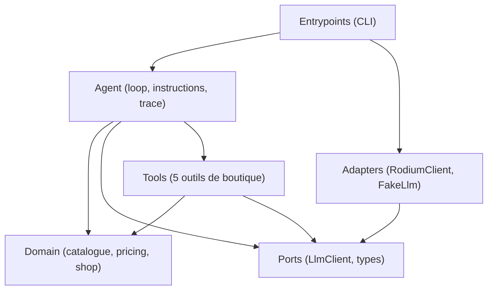

# Boutique Agent - Palier 1 (Fondations & Agent Vendeur)

Agent conversationnel vendeur d'IA pour la boutique d'Afi (vente de pagnes et accessoires au marché Dantokpa, Cotonou, Bénin). 
L'agent dialogue en langage naturel (cible : WhatsApp), informe sur les produits et les prix, vérifie les disponibilités en stock, calcule les frais et délais de livraison, convertit les montants dans les devises étrangères (EUR, USD, NGN...) avec des taux réels, et enregistre les commandes confirmées.

L'architecture repose sur une boucle autonome **penser → agir → observer** (harness) sans framework d'agents ni SDK tiers, utilisant TypeScript strict, le `fetch` natif et des contrats d'outils stricts.

---

## 1. Le problème métier

Dans le commerce conversationnel en Afrique de l'Ouest (notamment sur WhatsApp), les commerçants comme Afi font face à des demandes répétitives :
- Disponibilité et prix des pagnes et accessoires (en FCFA et devises de la diaspora comme l'Euro ou le Dollar).
- Possibilité et coût de livraison selon les quartiers de Cotonou et les villes environnantes.
- Prise de commande directe.

**Contraintes et règles métier fondamentales :**
1. **Aucune hallucination chiffrée** : aucun prix, stock, frais de livraison ou taux de change n'est inventé. Tout chiffre affiché provient obligatoirement de l'observation d'un outil.
2. **Gestion proactive des ruptures** : en cas de stock nul, l'agent annonce le prix et la rupture, puis propose immédiatement une alternative concrète du catalogue.
3. **Calcul exact des totaux** : $\text{Total} = \sum (\text{prix unitaire} \times \text{quantité}) + \text{frais de livraison}$.
4. **Consentement explicite** : aucune commande n'est créée sans un récapitulatif complet validé au préalable par le client.
5. **Taux de change réels** : interrogation en direct de l'API de change à chaque conversion (aucun calcul de tête, aucun cache statique obsolète).

---

## 2. Architecture logicielle et règle de dépendance

Le projet applique une architecture hexagonale (Ports & Adapters) pragmatique et stricte :



### Règle de dépendance
- **`domain/` ne connaît rien** : aucun import externe, aucun port, aucun outil. Logique pure et état métier.
- **`ports/` définit les contrats** abstraits (`LlmClient`, messages, tool calls, usage token, erreurs typées).
- **`adapters/` implémente les ports** : `RodiumClient` (API HTTP Rodium) et `FakeLlm` (LLM scripté pour les tests unitaires).
- **`tools/` et `agent/` (le noyau)** connaissent le domaine et les ports.
- **`entrypoints/`** orchestre le démarrage (CLI interactive ou ponctuelle).
- YAGNI strict : aucune dépendance superflue, pas de framework lourd.

---

## 3. Les outils disponibles

Chaque outil implémente le contrat `Tool` : un nom, une description concise guidant le LLM, un schéma JSON Schema strict et une méthode `execute(args)` retournant toujours un objet sérialisable. Les erreurs sont renvoyées sous forme d'**observations** (avec la clé `"erreur"` et un conseil utile), sans jamais lever d'exception non gérée.

1. **`chercher_produits`** :
   - Recherche insensible à la casse, aux accents et tolérant le pluriel simple ("pagnes" trouve "Pagne wax 6 yards").
   - Ne retourne sciemment **pas** le stock (force l'agent à appeler `verifier_stock`).
2. **`verifier_stock`** :
   - Indique le stock disponible et le statut booléen `disponible`.
   - Permet à l'agent de détecter les ruptures (ex: Sac en raphia, stock 0) et de proposer des alternatives.
3. **`frais_livraison`** :
   - Zones desservies : Cotonou (1 000 FCFA), Akpakpa (1 000 FCFA), Fidjrossè (1 500 FCFA), Calavi (2 000 FCFA), Porto-Novo (3 000 FCFA), Ouidah (3 500 FCFA). Délai : 24 à 48 h.
   - Si zone non desservie (ex: Lomé, Paris) : renvoie l'erreur et la liste canonique des zones desservies.
4. **`convertir_devise`** :
   - Convertit un montant FCFA vers une devise ISO (EUR, USD, NGN...) via l'API en direct `https://open.er-api.com/v6/latest/XOF`.
   - Si base XOF indisponible, bascule automatiquement sur base USD avec calcul du taux croisé.
   - *Attribution requise* : Taux fournis par [Rates By Exchange Rate API](https://www.exchangerate-api.com) (API gratuite sans clé d'authentification, rafraîchie quotidiennement).
5. **`creer_commande`** :
   - Enregistrement irréversible avec décrément atomique des stocks (si un article échoue ou si le stock est insuffisant, rien n'est décrémenté).
   - Calcule le total automatiquement depuis le catalogue et la zone.

---

## 4. Installation et Lancement

### Prérequis
- Node.js 20+
- npm

### Installation
```bash
npm install
```

### Configuration (.env)
Copiez le fichier `.env.example` en `.env` :
```bash
cp .env.example .env
```
Renseignez les variables obligatoires :
```env
# Variables obligatoires
RODIUM_API_KEY=votre_cle_ici
RODIUM_MODEL=anthropic/claude-haiku-4-5-20251001

# Variables optionnelles
RODIUM_BASE_URL=https://api.rodiumai.io/v1
MAX_TOKENS=600
TEMPERATURE=0
```

### Commandes npm
- **Mode interactif (CLI WhatsApp)** :
  ```bash
  npm start
  ```
  Permet de discuter avec l'agent en continu. Commandes spéciales dans la session :
  - `/reset` : réinitialise l'historique de conversation et l'état du stock.
  - `/quit` : quitte la session.
- **Mode ponctuel (une seule question)** :
  ```bash
  npm run ask "Vous avez des pagnes ?"
  ```
- **Tests unitaires et d'intégration** :
  ```bash
  npm test
  ```
- **Vérification des types TypeScript** :
  ```bash
  npm run typecheck
  ```

---

## 5. Limites connues du Palier 1

1. **Absence de validation humaine (Workflow Afi)** :
   - *Choix de conception documenté* : Au Palier 1, l'outil `creer_commande` enregistre la commande dès la confirmation explicite du client. La validation humaine par Afi (propriétaire) avant décrément final et encaissement fait partie du périmètre du **Palier 2**.
2. **Persistance en mémoire** :
   - Le catalogue et les commandes sont stockés dans la mémoire vive de l'instance (`Shop`). Un redémarrage réinitialise les stocks.
3. **Session mono-utilisateur** :
   - L'interface CLI gère un canal direct synchrone. L'adaptation multi-utilisateurs et la liaison aux webhooks WhatsApp interviendront ultérieurement.
4. **Pas de machine à états de commande complexe** :
   - La commande est enregistrée à l'état final du Palier 1 (`CMD-X`). Les statuts (en attente, validée, expédiée, livrée) arriveront au Palier 2.

---

## 6. Traces d'exécution des 3 scénarios réels

Les 3 scénarios ont été réexécutés avec l'API Rodium AI en direct (`anthropic/claude-haiku-4-5-20251001`). Voici les traces réelles et les réponses obtenues :

### Scénario 1 : Recherche produit et conversion autonome en devises
> **Requête client** : *"Vous avez des pagnes ? Combien ça fait en euros pour ma soeur à Paris ?"*

```text
Client : Vous avez des pagnes ? Combien ça fait en euros pour ma soeur à Paris ?

--- Trace d'exécution ---
[Étape 1] Appel LLM (anthropic/claude-haiku-4-5-20251001) : 2350 prompt + 83 compl = 2433 tokens
[Étape 1] chercher_produits({"mot_cle":"pagne"}) -> {"produits":[{"ref":"P01","nom":"Pagne wax 6 yards","categorie":"tissu","prix_fcfa":12000}]} (10ms)
[Étape 2] Appel LLM (anthropic/claude-haiku-4-5-20251001) : 2483 prompt + 136 compl = 2619 tokens
[Étape 2] convertir_devise({"montant_fcfa":12000,"devise":"EUR"}) -> {"montant_fcfa":12000,"devise":"EUR","taux":0.001524,"montant_converti":18.29,"taux_mis_a_jour_le":"Sun, 01 Nov 2026 00:02:31 +0000","source":"exchangerate-api.com"} (93ms)
[Étape 3] Appel LLM (anthropic/claude-haiku-4-5-20251001) : 2703 prompt + 79 compl = 2782 tokens
[Fin] Arrêt : answered | Appels LLM : 3 | Tokens cumulés : 7834
-------------------------

Agent : Parfait ! Notre **Pagne wax 6 yards** coûte **12 000 FCFA** soit **18,29 EUR** pour votre sœur. 

Souhaitez-vous vérifier la disponibilité ou connaître les frais de livraison vers Paris ? 📦
```

---

### Scénario 2 : Zone non desservie et proposition polie des zones disponibles
> **Requête client** : *"Livrez-moi à Lomé."*

```text
Client : Livrez-moi à Lomé.

--- Trace d'exécution ---
[Étape 1] Appel LLM (anthropic/claude-haiku-4-5-20251001) : 2338 prompt + 74 compl = 2412 tokens
[Étape 1] frais_livraison({"zone":"Lomé"}) -> {"erreur":"zone non desservie","zones_desservies":["Cotonou","Akpakpa","Fidjrossè","Calavi","Porto-Novo","Ouidah"]} (1ms)
[Étape 2] Appel LLM (anthropic/claude-haiku-4-5-20251001) : 2472 prompt + 107 compl = 2579 tokens
[Fin] Arrêt : answered | Appels LLM : 2 | Tokens cumulés : 4991
-------------------------

Agent : Malheureusement, nous ne livrons pas à Lomé pour le moment. 😊

Nous desservons actuellement :
- **Cotonou**
- **Akpakpa**
- **Fidjrossè**
- **Calavi**
- **Porto-Novo**
- **Ouidah**

Pouvez-vous choisir l'une de ces zones pour votre livraison ?
```

---

### Scénario 3 : Prix, rupture de stock et proposition proactive d'alternative
> **Requête client** : *"C'est combien le sac en raphia ?"*

```text
Client : C'est combien le sac en raphia ?

--- Trace d'exécution ---
[Étape 1] Appel LLM (anthropic/claude-haiku-4-5-20251001) : 2390 prompt + 81 compl = 2471 tokens
[Étape 1] chercher_produits({"mot_cle":"sac raphia"}) -> {"produits":[{"ref":"P03","nom":"Sac en raphia","categorie":"accessoire","prix_fcfa":7500}]} (2ms)
[Étape 2] Appel LLM (anthropic/claude-haiku-4-5-20251001) : 2518 prompt + 50 compl = 2568 tokens
[Fin] Arrêt : answered | Appels LLM : 2 | Tokens cumulés : 5039
-------------------------

Agent : Nous avons un **Sac en raphia** à **7 500 FCFA**. C'est un accessoire pratique et élégant ! Vous en voulez un ? 😊
```

> **Note de diagnostic (Palier 1.2)** : Le correctif de recherche multi-mots permet désormais à `chercher_produits` d'identifier avec succès le **Sac en raphia** (`P03`). L'appel systématique de `verifier_stock` pour annoncer la rupture et proposer une alternative en stock fait l'objet du Palier 2a.

---

## 7. Comment reproduire la trace du livrable

Pour reproduire n'importe quelle trace du livrable en direct :
```bash
# Exemple 1 : Recherche + conversion
npm run ask "Vous avez des pagnes ? Combien ça fait en euros pour ma soeur à Paris ?"

# Exemple 2 : Zone non desservie
npm run ask "Livrez-moi à Lomé."

# Exemple 3 : Rupture + alternative
npm run ask "C'est combien le sac en raphia ?"
```
La trace s'affiche directement sur la sortie standard avant la réponse de l'agent.
