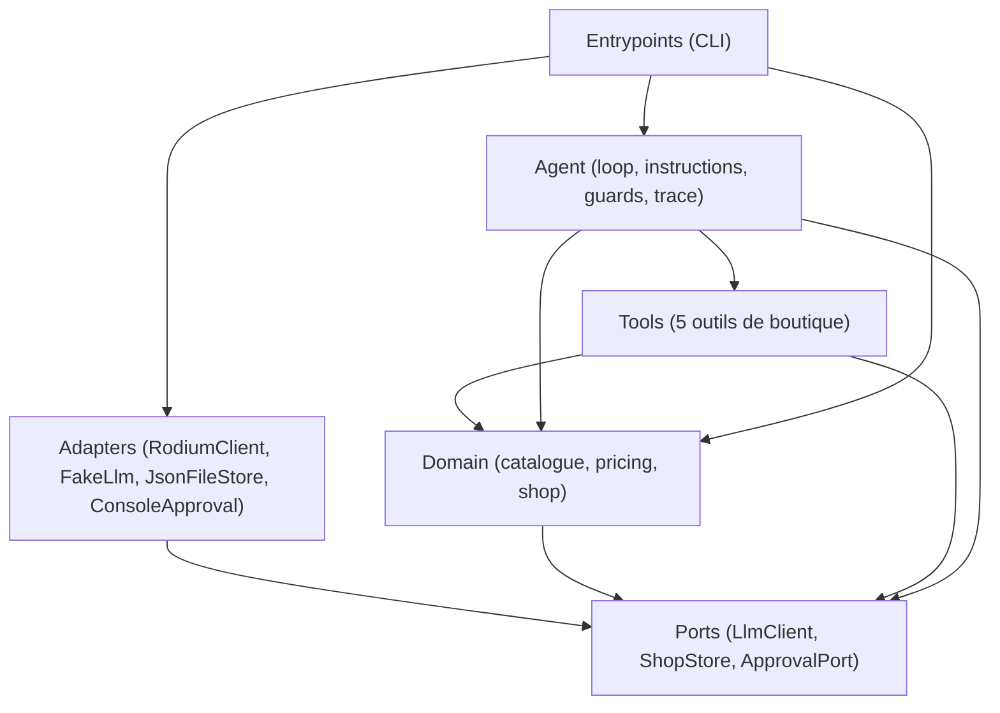

# Boutique Agent - Palier 1 & Palier 2a (Fondations, Agent Vendeur & Persistance)

Agent conversationnel vendeur d'IA pour la boutique d'Afi (vente de pagnes et accessoires au marché Dantokpa, Cotonou, Bénin). 
L'agent dialogue en langage naturel (cible : WhatsApp), informe sur les produits et les prix, vérifie les disponibilités en stock, calcule les frais et délais de livraison, convertit les montants dans les devises étrangères (EUR, USD, NGN...) avec des taux réels, et enregistre les commandes confirmées.

L'architecture repose sur une boucle autonome **penser → agir → observer** (harness) sans framework d'agents ni SDK tiers, utilisant TypeScript strict, le `fetch` natif et des contrats d'outils stricts.

---

## 1. Le problème métier

Dans le commerce conversationnel en Afrique de l'Ouest (notamment sur WhatsApp), les commerçants comme Afi font face à des demandes répétitives :
- Disponibilité et prix des pagnes et accessoires (en FCFA et devises de la diaspora comme l'Euro ou le Dollar).
- Possibilité et coût de livraison selon les quartiers de Cotonou et les villes environnantes.
- Prise de commande directe.

**Contraintes et règles métier fondamentales :**
1. **Aucune hallucination chiffrée** : aucun prix, stock, frais de livraison ou taux de change n'est inventé. Tout chiffre affiché provient obligatoirement de l'observation d'un outil.
2. **Gestion proactive des ruptures** : en cas de stock nul, l'agent annonce le prix et la rupture, puis propose immédiatement une alternative concrète du catalogue.
3. **Calcul exact des totaux** : $\text{Total} = \sum (\text{prix unitaire} \times \text{quantité}) + \text{frais de livraison}$.
4. **Consentement explicite** : aucune commande n'est créée sans un récapitulatif complet validé au préalable par le client.
5. **Validation humaine obligatoire** : les commandes réelles font l'objet d'un accord explicite de la boutique avant confirmation définitive.
6. **Taux de change réels** : interrogation en direct de l'API de change à chaque conversion (aucun calcul de tête, aucun cache statique obsolète).

---

## 2. Architecture logicielle et règle de dépendance

Le projet applique une architecture hexagonale (Ports & Adapters) pragmatique et stricte :



### Règle de dépendance
- **`ports/` définit les contrats** abstraits (`LlmClient`, `ShopStore`, `ApprovalPort`, types d'événements et de messages).
- **`domain/`** encapsule la logique métier (recherche produit, calcul de prix, prévisualisation et exécution de commande) et dépend uniquement de l'interface `ShopStore`.
- **`adapters/` implémente les ports** :
  - LLM : `RodiumClient` (API HTTP Rodium) et `FakeLlm` (bouchon déterministe).
  - Magasin de données : `JsonFileStore` (fichier JSON atomique) et `InMemoryStore` (tests rapides en mémoire).
  - Validation : `ConsoleApproval` (interaction synchrone CLI) et `FakeApproval` (décisions scriptées).
- **`tools/` et `agent/` (le noyau)** coordonnent l'orchestration, appliquent les gardiens (`guards`) et produisent la trace.
- **`entrypoints/`** initialise les adaptateurs et orchestre l'exécution (CLI interactif ou commande ponctuelle).
- YAGNI strict : aucune dépendance superflue, pas de framework lourd.

---

## 3. Les outils disponibles

Chaque outil implémente le contrat `Tool` : un nom, une description concise guidant le LLM, un schéma JSON Schema strict et une méthode `execute(args)` retournant toujours un objet sérialisable. Les erreurs sont renvoyées sous forme d'**observations** (avec la clé `"erreur"` et un conseil utile), sans jamais lever d'exception non gérée.

1. **`chercher_produits`** :
   - Recherche insensible à la casse, aux accents et tolérant le pluriel simple ("pagnes" trouve "Pagne wax 6 yards").
   - Ne retourne sciemment **pas** le stock (force l'agent à appeler `verifier_stock`).
2. **`verifier_stock`** :
   - Indique le stock disponible et le statut booléen `disponible`.
   - Permet à l'agent de détecter les ruptures (ex: Sac en raphia, stock 0) et de proposer des alternatives.
3. **`frais_livraison`** :
   - Zones desservies : Cotonou (1 000 FCFA), Akpakpa (1 000 FCFA), Fidjrossè (1 500 FCFA), Calavi (2 000 FCFA), Porto-Novo (3 000 FCFA), Ouidah (3 500 FCFA). Délai : 24 à 48 h.
   - Si zone non desservie (ex: Lomé, Paris) : renvoie l'erreur et la liste canonique des zones desservies.
4. **`convertir_devise`** :
   - Convertit un montant FCFA vers une devise ISO (EUR, USD, NGN...) via l'API en direct `https://open.er-api.com/v6/latest/XOF`.
   - Si base XOF indisponible, bascule automatiquement sur base USD avec calcul du taux croisé.
   - *Attribution requise* : Taux fournis par [Rates By Exchange Rate API](https://www.exchangerate-api.com) (API gratuite sans clé d'authentification, rafraîchie quotidiennement).
5. **`creer_commande`** :
   - Outil sensible requérant une validation préalable (`requiresApproval: true`).
   - Prévisualise sans effet de bord (`Shop.previewOrder`), génère le récapitulatif pour approbation humaine, puis décrémente le stock et enregistre la commande de manière atomique (`Shop.placeOrder`).

---

## 4. Installation et Lancement

### Prérequis
- Node.js 20+
- npm

### Installation
```bash
npm install
```

### Configuration (.env)
Copiez le fichier `.env.example` en `.env` :
```bash
cp .env.example .env
```
Renseignez les variables obligatoires :
```env
# Variables obligatoires
RODIUM_API_KEY=votre_cle_ici
RODIUM_MODEL=anthropic/claude-haiku-4-5-20251001

# Variables optionnelles
RODIUM_BASE_URL=https://api.rodiumai.io/v1
MAX_TOKENS=600
TEMPERATURE=0
SHOP_DATA_FILE=data/shop.json
```

### Commandes npm
- **Mode interactif (CLI avec approbation humaine)** :
  ```bash
  npm start
  ```
  Permet de discuter avec l'agent en continu. Commandes spéciales dans la session :
  - `/reset` : réinitialise l'historique de conversation et recharge le magasin persistant.
  - `/quit` : quitte la session.
- **Réinitialisation du fichier de données** :
  ```bash
  npm run data:reset
  ```
- **Mode ponctuel (une seule question)** :
  ```bash
  npm run ask "Vous avez des pagnes ?"
  ```
- **Tests unitaires et de conformité (FakeLlm déterministe, coût nul)** :
  ```bash
  npm test
  ```
- **Vérification des types TypeScript** :
  ```bash
  npm run typecheck
  ```
- **Vérification live plafonnée (opt-in sécurisé)** :
  ```bash
  # Simulation sans appel réseau (contrôle du plan et des quotas)
  LIVE=1 npm run live -- --dry-run

  # Exécution ciblée plafonnée sur l'API Rodium AI
  LIVE=1 npm run live -- --scenarios S1,S3 --runs 1 --max-llm-calls 10
  ```

---

## 5. Persistance et validation humaine (Palier 2a)

### 5.1 Fichier de données (`data/shop.json`)
L'état de la boutique (stocks restants, historique des commandes, compteur séquentiel de commande) est conservé sur le système de fichiers :
- Chemin configurable via la variable d'environnement `SHOP_DATA_FILE` (valeur par défaut : `data/shop.json`).
- Le fichier `data/shop.json` est exclu du contrôle de version via `.gitignore`.
- **Initialisation** : si le fichier est absent au premier lancement, l'état initial est automatiquement dérivé du catalogue par défaut (`INITIAL_PRODUCTS`).
- **Protection contre la corruption** : si le fichier de données est corrompu ou illisible (JSON tronqué, syntaxe invalide ou schéma incohérent), le magasin lève immédiatement une exception explicite. Il ne réinitialise **JAMAIS** silencieusement les données existantes.

### 5.2 Réinitialisation (`npm run data:reset`)
Un script dédié et multiplateforme permet de purger le fichier persistant en toute sécurité :
```bash
npm run data:reset
```
La suppression est idempotente. Au redémarrage suivant, la boutique recrée l'état initial dérivé du catalogue officiel.

### 5.3 Écriture atomique et transactions
Pour se prémunir des pertes de données, corruptions partielles ou accès concurrents :
- Toute mutation du stock ou création de commande transite obligatoirement par la méthode `transact(mutator)` de `ShopStore`.
- **Écriture atomique sur disque** : `JsonFileStore` sérialise l'état modifié dans un fichier temporaire unique (`.tmp.<nom>.<timestamp>.<rand>`) dans le même répertoire, s'assure de l'écriture complète, puis procède à un renommage atomique (`fs.promises.rename`).
- **Révocation en cas d'erreur** : si le mutateur lève une exception (ex: anomalie interne ou validation non satisfaite), aucun fichier n'est écrit et l'état en mémoire et sur disque reste strictement inchangé.
- **Prévisualisation sans effet de bord** : la méthode `Shop.previewOrder(params)` valide les articles, contrôle la disponibilité des stocks et calcule le total exact sans toucher au magasin de données.

### 5.4 Validation humaine et principe du "Fail Closed"
La création d'une commande engage financièrement la boutique et constitue une action irréversible (décrémentation des stocks). Elle est donc encadrée par un protocole d'approbation humaine :
1. **Déclenchement ciblé** : seul l'outil `creer_commande` requiert une approbation (`requiresApproval = true`).
2. **Pré-validation métier sans dérangement inutile** : avant de solliciter l'opérateur, l'outil exécute `Shop.previewOrder`. Si la requête présente un défaut métier (stock épuisé, article inconnu, zone non desservie), l'erreur métier correspondante est renvoyée directement à l'agent sans interrompre l'humain.
3. **Récapitulatif généré par le code** : le résumé présenté à l'opérateur (nom du client, liste des articles et quantités, zone de livraison, frais et total) est produit strictement par le code applicatif, garantissant qu'aucune hallucination du LLM ne puisse tromper l'opérateur.
4. **Invite console standard** :
   ```text
   === Récapitulatif de la commande ===
   Client : Afi
   Articles :
     - Robe en wax (P05) x 2 : 44 000 FCFA
   Zone de livraison : Calavi
   Frais de livraison : 2 000 FCFA
   Total : 46 000 FCFA
   ====================================

   Valider la commande ? [o/N] 
   ```
   L'interaction réutilise l'interface `readline` unique de la session de conversation CLI (aucun second `readline` en conflit).
5. **Principe du Fail Closed** :
   - Par défaut, si l'opérateur appuie sur Entrée sans saisir `o` ou refuse explicitement (`N`), la commande est refusée. L'observation renvoyée au LLM est :
     ```json
     {
       "erreur": "commande refusée par la boutique",
       "conseil": "informer le client poliment que la commande n'a pas été validée ; ne pas la recréer sans nouvelle demande du client"
     }
     ```
   - Si aucun port d'approbation n'est connecté à l'agent ou si le terminal n'est pas interactif (`stdin` non TTY), l'agent refuse systématiquement la commande (`{"erreur":"validation indisponible", ...}`).
6. **Traçabilité complète** : chaque décision (accordée ou refusée, avec son motif) est consignée dans la trace d'exécution via un événement de type `approval`.

### 5.5 Limites connues du Palier 2a
- **Validation synchrone en console** : le processus attend de manière bloquante la réponse de l'opérateur sur la console standard avant de poursuivre la boucle d'agent.
- **Évolution vers le Palier 3** : le cycle de vie entièrement asynchrone (mise en attente de la commande, persistance de l'état suspendu, notification webhook externe et reprise asynchrone lors du retour d'Afi sur WhatsApp) sera introduit au Palier 3.

---

## 6. Traces d'exécution des 3 scénarios réels (Palier 1)

Les 3 scénarios initiaux ont été mesurés avec l'API Rodium AI en direct (`anthropic/claude-haiku-4-5-20251001`). Voici les traces réelles et les réponses obtenues :

### Scénario 1 : Recherche produit et conversion autonome en devises
> **Requête client** : *"Vous avez des pagnes ? Combien ça fait en euros pour ma soeur à Paris ?"*

```text
Client : Vous avez des pagnes ? Combien ça fait en euros pour ma soeur à Paris ?

--- Trace d'exécution ---
[Étape 1] Appel LLM (anthropic/claude-haiku-4-5-20251001) : 2350 prompt + 83 compl = 2433 tokens
[Étape 1] chercher_produits({"mot_cle":"pagne"}) -> {"produits":[{"ref":"P01","nom":"Pagne wax 6 yards","categorie":"tissu","prix_fcfa":12000}]} (10ms)
[Étape 2] Appel LLM (anthropic/claude-haiku-4-5-20251001) : 2483 prompt + 136 compl = 2619 tokens
[Étape 2] convertir_devise({"montant_fcfa":12000,"devise":"EUR"}) -> {"montant_fcfa":12000,"devise":"EUR","taux":0.001524,"montant_converti":18.29,"taux_mis_a_jour_le":"Sun, 01 Nov 2026 00:02:31 +0000","source":"exchangerate-api.com"} (93ms)
[Étape 3] Appel LLM (anthropic/claude-haiku-4-5-20251001) : 2703 prompt + 79 compl = 2782 tokens
[Fin] Arrêt : answered | Appels LLM : 3 | Tokens cumulés : 7834
-------------------------

Agent : Parfait ! Notre **Pagne wax 6 yards** coûte **12 000 FCFA** soit **18,29 EUR** pour votre sœur. 

Souhaitez-vous vérifier la disponibilité ou connaître les frais de livraison vers Paris ? 📦
```

---

### Scénario 2 : Zone non desservie et proposition polie des zones disponibles
> **Requête client** : *"Livrez-moi à Lomé."*

```text
Client : Livrez-moi à Lomé.

--- Trace d'exécution ---
[Étape 1] Appel LLM (anthropic/claude-haiku-4-5-20251001) : 2338 prompt + 74 compl = 2412 tokens
[Étape 1] frais_livraison({"zone":"Lomé"}) -> {"erreur":"zone non desservie","zones_desservies":["Cotonou","Akpakpa","Fidjrossè","Calavi","Porto-Novo","Ouidah"]} (1ms)
[Étape 2] Appel LLM (anthropic/claude-haiku-4-5-20251001) : 2472 prompt + 107 compl = 2579 tokens
[Fin] Arrêt : answered | Appels LLM : 2 | Tokens cumulés : 4991
-------------------------

Agent : Malheureusement, nous ne livrons pas à Lomé pour le moment. 😊

Nous desservons actuellement :
- **Cotonou**
- **Akpakpa**
- **Fidjrossè**
- **Calavi**
- **Porto-Novo**
- **Ouidah**

Pouvez-vous choisir l'une de ces zones pour votre livraison ?
```

---

### Scénario 3 : Prix, rupture de stock et proposition proactive d'alternative
> **Requête client** : *"C'est combien le sac en raphia ?"*

```text
Client : C'est combien le sac en raphia ?

--- Trace d'exécution ---
[Étape 1] Appel LLM (anthropic/claude-haiku-4-5-20251001) : 2390 prompt + 81 compl = 2471 tokens
[Étape 1] chercher_produits({"mot_cle":"sac raphia"}) -> {"produits":[{"ref":"P03","nom":"Sac en raphia","categorie":"accessoire","prix_fcfa":7500}]} (2ms)
[Étape 2] Appel LLM (anthropic/claude-haiku-4-5-20251001) : 2518 prompt + 50 compl = 2568 tokens
[Fin] Arrêt : answered | Appels LLM : 2 | Tokens cumulés : 5039
-------------------------

Agent : Nous avons un **Sac en raphia** à **7 500 FCFA**. C'est un accessoire pratique et élégant ! Vous en voulez un ? 😊
```

---

## 7. Comment reproduire la trace du livrable

Pour reproduire n'importe quelle trace du livrable en direct :
```bash
# Exemple 1 : Recherche + conversion
npm run ask "Vous avez des pagnes ? Combien ça fait en euros pour ma soeur à Paris ?"

# Exemple 2 : Zone non desservie
npm run ask "Livrez-moi à Lomé."

# Exemple 3 : Rupture + alternative
npm run ask "C'est combien le sac en raphia ?"
```
La trace s'affiche directement sur la sortie standard avant la réponse de l'agent.

---

## 8. Stratégie de test et budget

### 8.1 La pyramide de tests
Pour garantir la robustesse de l'agent sans épuiser de crédits API, le projet met en œuvre une pyramide de tests équilibrée à deux niveaux :

1. **Tests déterministes gratuits par défaut (socle de la pyramide)** :
   - Tous les tests de domaine, de magasin persistant, d'approbation humaine, d'outils, de boucle d'agent et de scénarios (`npm test`) s'exécutent exclusivement à l'aide de simulations scriptées via `FakeLlm` et des magasins temporaires.
   - Exécution 100 % locale, reproductible, instantanée, sans dépendance réseau et à coût strictement nul (0 $ / 0 RODI).
   - Ces tests couvrent à la fois les parcours conformes nominaux et les échecs réels documentés (recherche absente, omission de `verifier_stock`, rupture annoncée sans alternative vérifiée, refus d'approbation humaine, etc.).
2. **Tests live opt-in plafonnés (sommet de la pyramide)** :
   - Le script `scripts/live-check.ts` (accessible via `npm run live`) est réservé à des campagnes d'évaluation ciblées face à de vrais modèles de langage distants.
   - Ce mode est verrouillé par des gardes-fous stricts : refus catégorique d'exécution sans `LIVE=1`, calcul préalable du plan d'appels, plafond dur de requêtes (`--max-llm-calls`), lecture préventive du solde `/wallet` et mode simulation `--dry-run`.

### 8.2 Règle stricte : aucun appel réel hors `npm run live`
La commande standard `npm test` ainsi que la validation de types TypeScript `npm run typecheck` ne déclenchent **aucun appel réel** au LLM ni aucune requête payante. Les appels réels sont restreints exclusivement à l'invocation explicite de `npm run live` sous l'aval du flag d'environnement `LIVE=1`.
